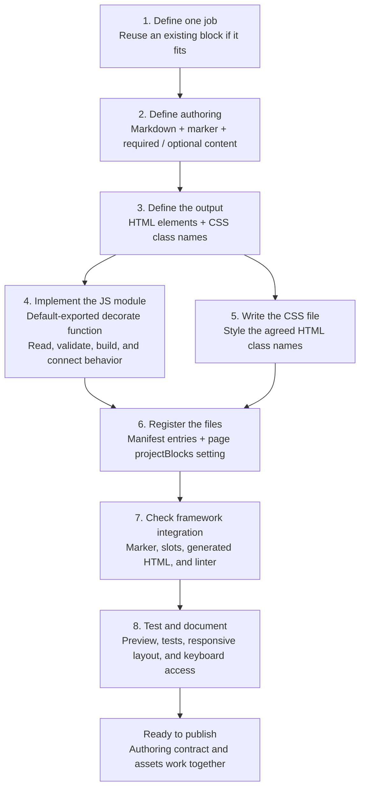

# Building a Project-Owned DevDocs Block

Build a block from the author's content outward. Define what authors write,
what HTML the block produces, and which CSS selectors style that HTML before
adding complex JavaScript.

This guide describes the project-block integration used by this repository.
The callout below is an illustrative new block, not an installed component.

## File Structure

Use one lowercase block name consistently in its folder, filenames, and
manifest key. For example, a proposed `Callout` component would use:

```text
src/pages/
  example.md                         Author's page and component marker
  blocks/
    project-blocks.js                 Existing shared project resolver
    callout/
      callout.js                     Block's JavaScript ES module
      callout.css                    Block's stylesheet
      images/                        Optional block-owned assets
static/
  blocks/
    blocks.json                      Existing block asset manifest
test/
  blocks/
    callout/
      callout.spec.mjs                Block tests
```

This tree is a proposed example. For an implemented block, see the current
[page](src/pages/index.md),
[JavaScript](src/pages/blocks/storefronthome/storefronthome.js),
[CSS](src/pages/blocks/storefronthome/storefronthome.css), and
[tests](test/blocks/storefronthome/storefronthome.spec.mjs).

Keep the JSON manifest in `static/blocks/`, not `src/pages/blocks/`. The preview
serves it at `/commerce/storefront/blocks/blocks.json`. Resource paths in the
manifest resolve relative to that public URL; the JS and CSS are authored under
`src/pages/blocks/`.

## Required Versus Optional

| Piece | Technical Role |
| --- | --- |
| Default-exported function in the block's JavaScript | Required for the runtime to execute custom rendering code. Conventionally written as `export default function decorate(block)`. |
| The name `decorate` | A convention, not a reserved keyword. The loader calls the default export, not a function looked up by name. A named export alone is not sufficient. |
| The `block` argument | The existing HTML element supplied by DevDocs. It is not the raw Markdown file or a content object. |
| Block JS and CSS manifest entries | Both resource paths are required by this project's resolver to select project-owned assets. |
| `projectBlocks` page frontmatter | Selects the project's resolver module. It points to JavaScript, not directly to the JSON manifest. |
| Markdown component marker and `slots` | Tell the connector which block to create and how many following Markdown nodes to place inside it. |
| `PAGE_TEMPLATE` and an HTML `<template>` element | Optional implementation choices. They are useful for a larger HTML skeleton but are not required by DevDocs. |
| `readContent`, `renderPage`, and other helpers | Optional functions you define to keep the implementation understandable. DevDocs does not call them directly. |
| CSS class names | Names you choose to connect generated HTML to stylesheet selectors. A class has no built-in appearance. |
| Section names such as `Hero` | Custom parser identifiers in `StorefrontHome`, not Markdown or Adobe keywords. Document names an author must preserve. |

The runtime also passes the block name, browser document, and eager-loading
flag after the block argument. A simple block only needs `block`. The loader
awaits the default export, so it may be an `async` function if necessary.

## Development Process

### 1. Define One Job

Decide what the block does and whether an existing block already fits. Start
with one purpose, such as displaying a callout or organizing related links.
Specify the visual goal separately from the content structure.

### 2. Define the Authoring Contract

Write the Markdown example first. Decide which values are required, optional,
or repeatable and how missing content should behave.

For the proposed callout, one paragraph is enough:

```markdown
---
title: Example
projectBlocks: blocks/project-blocks.js
---

<Callout slots="content" />

Configure your storefront before publishing it.
```

The connector consumes consecutive **top-level Markdown nodes** after the
marker. One slot consumes one node by default: a paragraph, heading, or entire
list. A blank line does not create a slot. Two separate paragraphs are two
nodes. With `repeat="N"`, the number consumed is `N` times the slot count.

The slot name `content` does not automatically map text into a JavaScript
variable. Your rendering code reads the resulting HTML cell.

`StorefrontHome` uses a specialized contract: its one `heading` slot consumes
the first section heading, then its JavaScript explicitly reads nearby content
and heading wrappers. That behavior is not automatically provided to new blocks.

### 3. Define the Output HTML and CSS Classes

Agree on the content-to-HTML mapping before implementing it:

| Author Supplies | JavaScript Produces | CSS Targets |
| --- | --- | --- |
| Callout paragraph | `<aside class="callout__content">...</aside>` | `.callout .callout__content` |

The connector creates nested block rows and cells. DevDocs adds the `block`
class, block metadata, and a block-name wrapper. Inspect the real preview HTML
to confirm that structure instead of guessing from the Markdown.

### 4. Implement the Default Entry Point

The block file is a browser JavaScript ES module. DevDocs imports it and calls
its default-exported function. You do not call `decorate()` from Markdown or
add a script tag to the page.

A minimal implementation for the one-paragraph example is:

```javascript
export default function decorate(block) {
  const contentCell = block.querySelector(':scope > div > div');
  if (!contentCell) return;
  if (!contentCell.textContent.trim()) return;

  const callout = document.createElement('aside');
  callout.className = 'callout__content';
  callout.append(...contentCell.childNodes);

  block.replaceChildren(callout);
}
```

This reads the first cell, validates its content, creates the output element,
and moves the existing nodes into it. Moving nodes preserves authored links
and formatting. Invalid input stays untouched.

For a larger block, keep the entry point short and separate reading, validation,
rendering, and interaction wiring into clearly named helpers. Use `textContent`
for plain text, or preserve already-parsed nodes. Do not interpolate authored
content into `innerHTML`.

### 5. Write the Stylesheet

CSS is written manually against the generated HTML. DevDocs loads the CSS
registered for the block; the block JavaScript does not need to import it.

```css
.callout .callout__content {
  margin: 0;
  padding: 16px;
  border-left: 4px solid #0066d2;
  background: #f2f6fb;
}
```

Scope styles to the block. Use browser DevTools **Styles** and **Computed** to
inspect inherited rules and parent width constraints. Add responsive behavior,
hover states, and visible keyboard focus where relevant. Values such as padding
and color come from the design, not from the Markdown or class names.

### 6. Register the Resources

Add the new block to the existing [manifest](static/blocks/blocks.json), keeping
the existing registrations. An illustrative manifest containing both blocks is:

```json
{
  "storefronthome": {
    "js": "storefronthome/storefronthome.js",
    "css": "storefronthome/storefronthome.css"
  },
  "callout": {
    "js": "callout/callout.js",
    "css": "callout/callout.css"
  }
}
```

Each page using project blocks needs the `projectBlocks` frontmatter shown
above. Reuse the existing [resolver](src/pages/blocks/project-blocks.js); do not
create a resolver per block. It returns absolute JS and CSS URLs or `null` for
shared fallback. Resources must remain on the same origin within the project's
path prefix and use the expected file extensions.

The generic loader and connector integration must be deployed before publishing
project-owned blocks. Once that integration exists, registering a new block does
not normally require changes to the companion repositories.

### 7. Check the Connector and Linter Contract

Before expanding the implementation, verify that the marker produces the
expected block name, rows, cells, and attributes in the preview.

The shared Markdown linter has a fixed component allowlist. A new marker may
need upstream allowlist support or an explicitly approved page-scoped exception.
The existing [package configuration](package.json) exempts `src/pages/index.md`
from `no-html-tags`; it does not automatically cover another page. Do not disable
the rule repository-wide or modify the downloaded linter as a workaround.

### 8. Test and Document

Use the existing [Playwright configuration](playwright.config.mjs) and put tests
under `test/blocks/`. Cover required and optional content, malformed input,
preserved links, long text, and interactions. Inspect the actual connector output
as well as isolated fixtures. Check desktop and mobile widths and keyboard access.

Run the existing commands from the repository root:

```bash
npm run preview
npm run test:blocks
npm run lint
```

Keep preview running in its terminal and run checks in another terminal. Run
`npm run test:preview` when changing proxy or asset-delivery behavior, not for
every CSS edit. See the [README](README.md#local-preview) for environment setup.

Document the Markdown contract for authors and the HTML/class-name map for
developers. Record required names, omission behavior, and any framework-specific
assumptions. Start with the smallest working block and add complexity only when
its content or behavior requires it.

## Diagrams

The first diagram summarizes the development process above. The second shows
how the files and functions work together when the finished block loads.

### Big Picture

Start with the authoring contract and intended HTML. Implement the JavaScript
and CSS against that shared structure, register the files, then verify and
document the block.



JavaScript and CSS both depend on the agreed HTML structure. The connector
produces the initial HTML, and the block JavaScript transforms it. CSS does not
read Markdown or create HTML. `PAGE_TEMPLATE` is an optional starting structure,
not another required framework file.

### Detailed StorefrontHome Process

This diagram follows the current block implementation. Other blocks use the
same runtime entry point but can have different helper functions and authoring
contracts.

```mermaid
flowchart TB
    subgraph framework["1. Connector and DevDocs runtime"]
        page["index.md<br/>Frontmatter + marker + Markdown content"]
        convert["Connector parses the page<br/>and reads the component marker"]
        slots["Consume following top-level Markdown nodes<br/>Node count = slot count * repeat"]
        initial["Create block HTML<br/>Rows and cells contain the consumed content"]
        wrappers["DevDocs adds block metadata<br/>and content / heading wrappers"]
        resolver["Load the page's project resolver<br/>Call its default export with the block name"]
        manifest["Resolver reads static/blocks/blocks.json<br/>Return JS + CSS URLs, or shared-asset fallback"]
        parallel["Start CSS loading and JS import in parallel"]
        cssLoad["Load storefronthome.css"]
        jsImport["Import storefronthome.js"]
        entry["Call the block module's default export<br/>Our function: decorate(block)"]

        page --> convert --> slots --> initial --> wrappers
        wrappers --> resolver --> manifest --> parallel
        parallel --> cssLoad
        parallel --> jsImport --> entry
    end

    subgraph implementation["2. Our StorefrontHome JavaScript"]
        read["readContent(block)"]
        parse["readSections: group recognized headings<br/>readFields: read Label: value paragraphs<br/>readAudience: read category headings and lists"]
        valid{"Are included sections valid?"}
        untouched["Return without changing the source HTML"]
        prepare["renderPage(content)<br/>Parse PAGE_TEMPLATE into template.content"]
        areas["Render each area<br/>renderHero / renderShortcuts<br/>renderSearch / renderDirectory"]
        omitted{"Is the area omitted?"}
        remove["Remove its unused template elements"]
        populate["Fill text and move authored links<br/>createTag / createIcon / createAudience as needed"]
        bind["connectSearch(page)<br/>Attach a submit handler only if Search exists"]
        insert["block.replaceChildren(page)<br/>Insert the prepared HTML"]
        cleanup["removeSourceContent(block, content)<br/>Remove consumed source and empty wrappers<br/>Keep nodes moved into the finished page"]
        scope["Add page styling scope<br/>and analytics attribute"]

        entry --> read --> parse --> valid
        valid -- "No" --> untouched
        valid -- "Yes" --> prepare --> areas --> omitted
        omitted -- "Yes" --> remove --> bind
        omitted -- "No" --> populate --> bind
        bind --> insert --> cleanup --> scope
    end

    complete["Block's default-exported function finishes"]
    loaded["DevDocs waits for CSS loading and decoration<br/>Then marks the block loaded"]
    display["Browser displays the HTML<br/>CSS selectors match its class names"]
    submit["Later: user submits homepage Search"]
    header["Submit handler opens header Search<br/>Copies query, dispatches input, and focuses field"]

    untouched --> complete
    scope --> complete
    complete --> loaded
    cssLoad --> loaded
    loaded --> display
    display -. "only if Search is included" .-> submit
    submit --> header
```



The area decision repeats for the included and omitted areas; it is not a
single all-or-nothing decision for the page. When Hero, Shortcuts, and Search
are all absent, `renderPage` also removes the empty top band. With no audiences,
it removes the directory; with one audience, CSS gives it the available width.

Important distinctions:

- **Framework entry point:** DevDocs calls the block module's default export.
  The name `decorate` and the helper functions are conventions in our code.
- **Content boundary:** `StorefrontHome` reads content after its one heading
  slot explicitly; new blocks do not automatically receive that entire document.
- **Validation versus omission:** Missing areas are allowed. Malformed included
  areas cause this implementation to keep the source HTML untouched.
- **HTML versus styles:** The JavaScript adds elements and class names. The
  browser applies matching CSS rules, including shared DevDocs styles.
- **Initial load versus interaction:** `connectSearch` registers the handler
  during rendering. The handler runs only when the user submits Search later.
- **Parallel loading:** Do not assume CSS is loaded when the block function
  starts. The runtime waits for CSS loading and decoration before marking it loaded.
